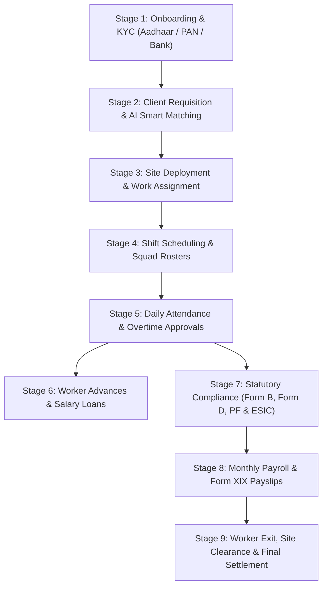

# Complete Administrator Guide: Worker Lifecycle from Onboarding to Exit in StaffifyGo

Welcome to the **StaffifyGo Administrator Guide**. This document explains in very simple, easy-to-follow English everything an Admin or Operations Manager can do in the platform across the entire lifecycle of a worker—from the day they are registered, to their site deployments, daily attendance, PF/ESI statutory compliance, salary payouts, and final exit settlement.

---

## The 9 Stages of the Worker Lifecycle

---

## Stage 1: Worker Onboarding & ID Verification

### 1.1 The Workers Directory
**Route**: `/workers`

This is your central command center for all workforce talent on your bench. You can see at a glance who is currently working on site, who is sitting on the bench available for new deployment, and whether their identity documents are verified.

#### What the Admin Can Do Here:
* **Filter workers** by Status (`Available`, `Deployed`, `On Leave`) or Trade (`Security`, `IT`, `Facilities`, `Logistics`, `General`).
* **Search instantly** by name, worker ID (e.g., `WRK-8001`), skill keyword, or phone number.
* **View KYC Verification Badges**: Green checkmarks confirm Police Verification and Aadhaar linkage.
* **Open Worker Profiles** or print a **Gate Pass** with one click.

---

### 1.2 Step-by-Step: Adding a New Worker to the Bench
To onboard a new person, click the blue **`+ Add Worker`** button in the top-right corner.

#### Easy Steps to Fill:
1. **Personal Information**:
   - Enter **Full Name** (e.g., `Ramesh Kumar`) and **Mobile Number**.
   - Enter **Email Address** (optional for field workers).
   - Select **Trade Category** (`Security`, `Facilities`, `Logistics`, `IT`, etc.).
   - Enter **Primary Skill** (e.g., `Armed Security Guard`, `Electrician`, `Forklift Driver`) and **Years of Experience**.
2. **Salary & Commercials**:
   - Enter **Agreed Daily or Monthly Rate** (e.g., `Rs 24,000` per month).
3. **Statutory & Government ID Verification (KYC)**:
   - Enter **Aadhaar Number** (12 digits) and check *Aadhaar Verified*.
   - Enter **PAN Number** (10 alphanumeric characters).
   - Enter **UAN Number** (Universal Account Number for Employee Provident Fund).
   - Enter **ESIC IP Number** (Employee State Insurance Corporation code).
   - Select **Police Verification Status** (`Verified`, `Pending`, or `Under Process`).
4. **Bank Account Details**:
   - Enter **Bank Name** (e.g., `State Bank of India`, `HDFC Bank`).
   - Enter **Account Number** and **IFSC Code** for direct salary bank transfers.
5. Click **`Save & Add to Bench`**.

> [!NOTE]
> The moment you save, the worker is placed on the **Talent Bench** in `AVAILABLE` status, ready to be assigned to any client requisition or work site.

---

### 1.3 Issuing Worker Gate Pass & ID Card
Every deployed worker needs an official photo ID and gate pass for client entry. In StaffifyGo, this is standard, laminated-ready, and generated instantly.

#### How to Generate:
1. In the Workers table, click the **`Gate Pass`** icon next to any worker.
2. The system renders a standard **CR80 Laminated ID Card** containing:
   - Worker Photo placeholder, Full Name, and Worker ID.
   - Trade Badge (e.g., *Full Stack Engineer*, *Armed Security Guard*).
   - Authorized Client Work Site (e.g., *Titanium Tech Hub Enterprises - E-City Campus*).
   - Police Clearance Seal & Medical Fitness verification tick.
   - Emergency Blood Group and Verified Phone Number.
   - Scannable QR Verification Code for security gate checkpoint scanners.
   - Authorized Contractor Signatory seal.
3. Click **`Print ID Card`** to output directly to any PVC card or paper printer.

---

### 1.4 Worker Profile & KYC Dossier Drawer
Clicking **`Profile`** opens a sliding right-hand drawer showing complete 360-degree history.

#### What You Can Review:
* **Active Site Deployment**: Where the worker is stationed, under which client contract, and their daily billing rate.
* **Statutory Compliance**: Full record of PAN, Aadhaar, UAN, and ESIC numbers.
* **Bank Remittance Coordinates**: Verified account number and IFSC branch details.
* **Recent Pay Slips & Attendance Record**: Historical days worked, overtime hours logged, and net salary payouts.

---

## Stage 2: Client Demands & Smart AI Candidate Matching

### 2.1 Managing Client Hiring Demands
**Route**: `/requisitions`

When a client needs additional staff (e.g. 5 Security Guards or 2 HVAC Technicians), you log the requirement here.

#### Admin Actions:
* **Post Job Demand**: Specify client, site location, required trade, positions needed (quota), and billing rate.
* **Track Fulfillment**: Real-time progress bar (e.g., `1 / 5 Filled - 4 Remaining`).
* **Urgency Indicators**: `CRITICAL` badges highlight demands that must be staffed immediately.

---

### 2.2 1-Click AI Candidate Smart Matching
Instead of manually sifting through hundreds of profiles, click **`Allocate`** on any open demand.

#### How the AI Matcher Works:
1. Click the **`AI Match Candidates`** button.
2. The AI matching algorithm instantly evaluates all available bench workers across 5 dimensions:
   - **Trade Match (35%)**: Does the worker belong to the requested trade?
   - **Skills & Keywords (30%)**: Does their experience match the specific tools or responsibilities?
   - **Experience Requirement (15%)**: Do they satisfy minimum required years?
   - **Police Verification (10%)**: Has their background check been cleared?
   - **Medical & Statutory (10%)**: Are Aadhaar, PAN, and Bank details fully verified?
3. The system highlights candidates with sparkling match score badges (e.g., `64% Match`, `98% Match`) and clear explanations:
   - *Example: "Exact trade match: Security | 6y exp meets requirement (>= 1y) | Police verification verified"*.
4. Top matching candidates are **automatically selected** to fill open slots.
5. Click **`1-Click Allocate`** to deploy all selected workers instantly.

---

## Stage 3: Work Assignments & Site Deployments

**Route**: `/deployments`

This screen tracks every active worker deployed across client facilities.

#### Key Details Displayed:
* **Worker & Trade**: Name, ID, trade badge.
* **Client & Delivery Site**: E.g., *Novartis Healthcare Logistics India - BKC Corporate HQ*.
* **Contract & PO Link**: Links the placement to the client's approved Purchase Order.
* **Commercial Rates**: Shows both the **Bill Rate** (what you charge the client) and **Pay Rate** (what you pay the worker), giving you gross margin visibility.
* **Tour Dates**: Start Date, Scheduled End Date, and current Status (`ACTIVE`, `COMPLETED`, `ENDED EARLY`).

---

## Stage 4: Shift Schedules & Squad Rostering

**Route**: `/shifts`

For 24/7 client operations (like security, facility maintenance, and factory logistics), workers must be organized into shift schedules.

#### Admin Actions:
* **Configure Shift Timings**:
  - **Morning Shift (A)**: `06:00 AM – 02:00 PM`
  - **General Shift (G)**: `09:00 AM – 06:00 PM`
  - **Night Shift (C)**: `10:00 PM – 06:00 AM`
* **Squad Roster Planning**: Group workers into squads (e.g., *Alpha Security Squad*, *Bravo Maintenance Team*) and assign weekly rotations.
* **Shift Handover Logs**: Track supervisor notes and handover remarks between shifts.

---

## Stage 5: Daily Attendance, Overtime & Approvals

**Route**: `/attendance`

Attendance is the foundation of accurate payroll and statutory compliance. StaffifyGo provides a site-based muster roll sheet.

#### How to Manage Attendance:
1. Select the **Client Site** (e.g., *Titanium Tech Hub Enterprises*) and the **Month**.
2. Review the attendance records:
   - **Days Present** (e.g., `26 days`).
   - **Days Absent / On Leave**.
   - **Overtime Hours (OT)**: E.g., `12 hrs`, `18 hrs` (Overtime is compensated at 1.5x statutory minimum).
   - **Gross Wages Earned**: Automatically calculated based on days worked + OT hours.
3. Review worker status lozenges (`PRESENT`, `LATE`, `WFH`, `ABSENT`).
4. Click **`Approve Attendance`** to lock the month's attendance sheet. Once locked, figures flow directly into the Salary & Payroll calculation engine.

---

## Stage 6: Worker Advances & Salary Loans

**Route**: `/loans`

Blue-collar and contract workers frequently require financial advances for medical or family emergencies. StaffifyGo manages these loans so you never lose track of money owed.

#### Step-by-Step: Issuing and Recovering an Advance
1. Click **`New Advance Request`**.
2. Select the worker, enter the **Loan Amount** (e.g., `Rs 15,000`), purpose, and choose the number of monthly installments (e.g., 3 months @ `Rs 5,000`/month).
3. Approve and disburse the advance.
4. **Automatic Salary Deduction**: Every month when you run payroll, the system automatically deducts the scheduled EMI amount (`Rs 5,000`) from the worker's salary slip and credits the loan balance.
5. **Exit Settlement Safeguard**: If the worker leaves the company before repaying in full, the remaining balance is automatically offset against their final payout.

---

## Stage 7: Statutory Compliance & Labor Law Registers

**Route**: `/compliance`

Government labor inspectors require strict adherence to labor laws. StaffifyGo generates official registers ready for inspection.

#### Available Statutory Registers:
* **Form B — Wage Register**: Conforms to Rule 78(1)(a)(i) of the Contract Labour (Regulation & Abolition) Central Rules. Lists basic wages, allowances, overtime hours, PF deductions (12%), ESIC deductions (0.75%), professional tax, and net payable.
* **Form D — Muster Roll**: Official attendance register showing daily punch records, weekly offs, and shifts.
* **Statutory Deductions Engine**:
  - **Employee PF (EPF)**: 12% of basic wage (matched by 12% employer contribution).
  - **Employee ESIC**: 0.75% of gross wage (for wages <= Rs 21,000/month; matched by 3.25% employer contribution).
  - **Professional Tax (PT)**: State-wise statutory slab (e.g., Rs 200/month in Maharashtra/Karnataka).
* **Labor Inspection Ready**: Click **`Print Register`** to print clean, unstyled, official white-paper reports with zero web elements.

---

## Stage 8: Monthly Payroll, Payslips & Billing

### 8.1 Calculating Monthly Salaries
**Route**: `/payroll`

With attendance approved, running monthly payroll takes seconds.

#### Easy Steps:
1. Click **`Calculate Salaries`**.
2. Select the **Billing Month** (e.g., `March 2026`) and target client site.
3. The system generates payroll records:
   - **Basic Wages**: Days worked $\times$ daily rate.
   - **Overtime Pay**: Total OT hours $\times 1.5\times$ hourly rate.
   - **Statutory Deductions**: EPF (12%), ESIC (0.75%), Professional Tax.
   - **Loan EMI Deductions**: Automatically deducted if the worker has an open advance.
   - **Take-Home Pay**: Net amount to be disbursed to the worker's bank account.
4. Click **`Approve Payroll`** to lock the payment batch.

---

### 8.2 Standard Form XIX Contractor Payslip
Every worker receives an official, statutory-compliant salary slip conforming to Rule 78(1)(b).

#### What is on the Form XIX Payslip:
* **Contractor & Agency Details**: Company name, GSTIN, PAN, and License Number.
* **Worker Identifiers**: Full Name, Worker ID, Work Site, Days Worked (26 days), Overtime logged (12 hrs), Bank Account & IFSC.
* **Earnings Breakdown**: Basic Wages + Overtime Earnings = Total Gross Wages.
* **Deductions Breakdown**: EPF (12%), ESIC (0.75%), Professional Tax (PT), and Loan Deductions = Total Deductions.
* **Net Take-Home Pay**: Bold highlighted figure disbursed via direct NEFT/RTGS bank transfer.
* **Employer Statutory Contributions**: Transparent non-deductible employer PF and ESIC shares for worker awareness.
* **Dual Signature Blocks**:
  - Left: *Worker Signature / Thumb Impression*.
  - Right: *Authorized HR & Payroll Officer Signatory*.
* Click **`Print / Download PDF`** for an exact A4 portrait paper slip.

---

## Stage 9: Worker Exits, Clearances & Final Settlements

**Route**: `/settlements`

When a worker resigns, completes their contract, or is terminated, their exit must follow standard de-provisioning procedures.

#### Step-by-Step Exit Workflow:
1. **Initiate Resignation / Exit**:
   - Click **`Initiate Settlement`**, choose the worker, enter last working day and exit reason (e.g., *Contract Completed*, *Resigned*, *Medical Grounds*).
2. **Site Clearance Checklist**:
   - Check off returned items:
     - [x] Return of Client Access Gate Pass & Laminated ID
     - [x] Return of Uniforms & Safety PPE (Helmet, Safety Boots, High-Vis Jacket)
     - [x] Return of Site Tools, Equipment & Keys
     - [x] Supervisor Site Clearance Sign-off
3. **Automatic Loan Deduction Offset**:
   - If the worker still owes Rs 5,000 on an advance, the system automatically subtracts this amount from their unpaid days' wages.
4. **Final Payout Calculation**:
   $$\text{Final Take-Home Payout} = \text{Unpaid Wages} + \text{Leave Encashment} + \text{Notice Pay} - \text{Outstanding Loan Balance}$$
5. Click **`Approve Settlement`** and print the **Exit Settlement Voucher** for worker sign-off.

---

## Stage 10: Autonomous AI Copilot & Workforce Risk Watchdog

Click the floating blue sparkle button at the bottom-right of any screen to open the **StaffifyGo AI Manpower Copilot**.

### What the AI Does For You:
1. **Real-Time Risk Watchdog**:
   - Scans your database automatically for operational risks.
   - **PO Budget Exhaustion**: Warns you when a client PO exceeds 60% and alerts critically when it exceeds 80% of budget cap.
   - **KYC Gaps**: Alerts if an active deployed worker has missing Police Verification or unlinked Aadhaar.
   - **Overtime Fatigue**: Identifies workers logging more than 15 hours of overtime to prevent burnout.
   - **Unreturned Equipment**: Flags workers who exited without returning uniforms or ID badges.
   - **Unfulfilled Requisitions**: Reminds you of urgent client staffing slots still open.
2. **Grounded Natural Language Assistant**:
   - Ask anything in plain English (e.g., *"How many security guards are on the bench?"*, *"Audit PO budget burn rate"*, *"Show pending exit clearances"*).
   - Provides accurate answers grounded in live MongoDB data with **1-click action buttons** to navigate and fix issues immediately.

---

## Summary of Daily Admin Routine

| Time of Day | Recommended Action | Screen / Route |
| :--- | :--- | :--- |
| **Morning (09:00 AM)** | Check Dashboard & AI Watchdog for critical alerts (e.g. PO caps, unverified KYC). | `/` (Dashboard) |
| **Mid-day (12:00 PM)** | Review new client hiring demands and use **AI Match** to allocate bench candidates. | `/requisitions` |
| **Afternoon (03:00 PM)** | Verify attendance logs, approve overtime hours, and check shift roster rotations. | `/attendance` & `/shifts` |
| **Month-End (28th–31st)** | Run monthly salaries, verify PF/ESI deductions, and print Form XIX payslips. | `/payroll` & `/compliance` |
| **As Needed** | Issue worker gate passes, approve salary advances, and process exit clearances. | `/workers`, `/loans`, `/settlements` |

With this workflow, every worker's journey is transparent, error-free, legally compliant, and automated from end to end.
